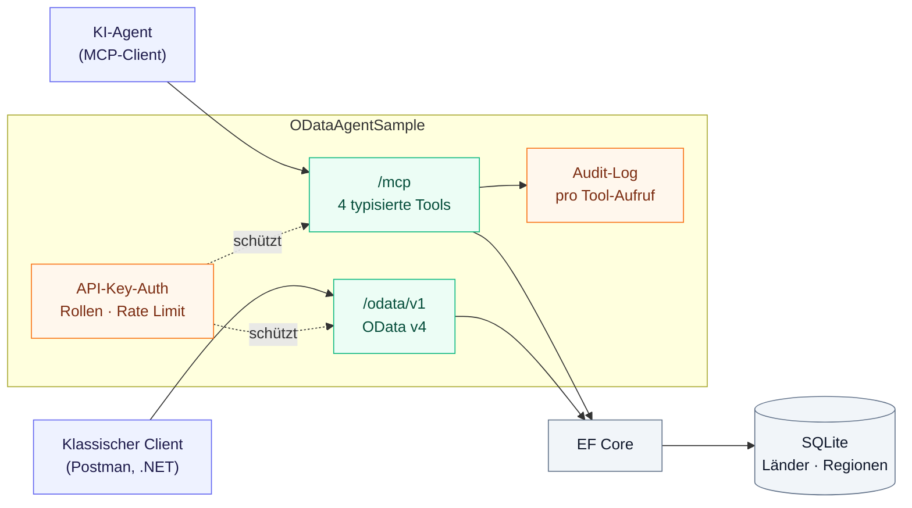
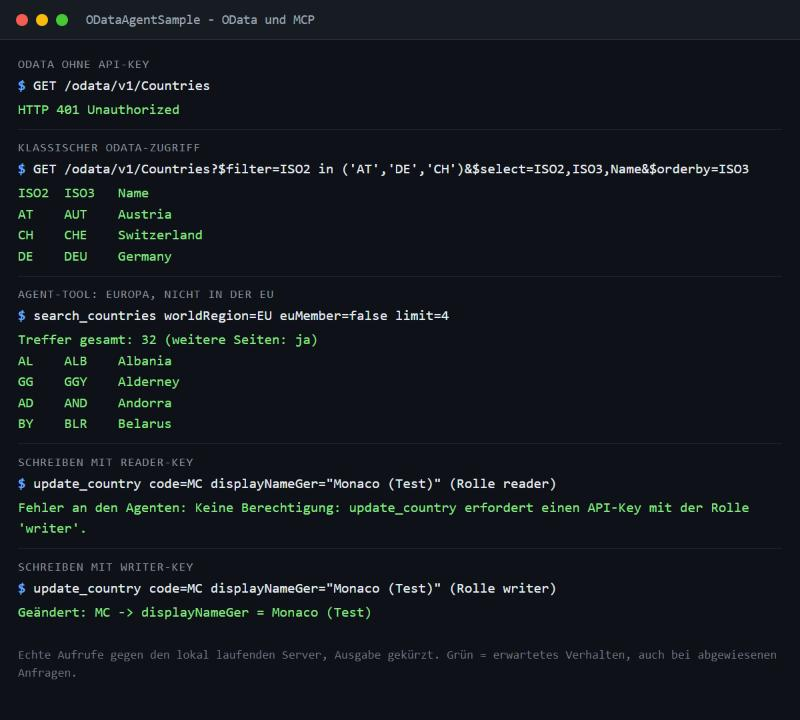
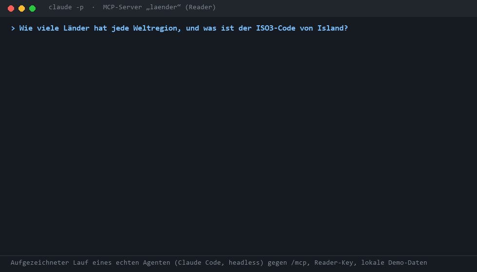
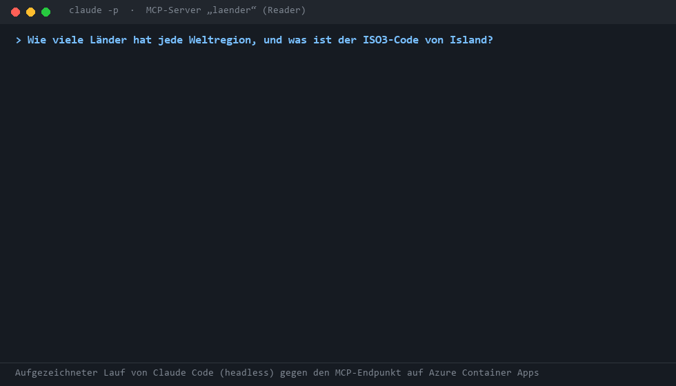

# ODataAgentSample
[](https://github.com/vompa/ODataAgentSample/actions/workflows/ci.yml)


**Vom OData-Service zum KI-Agenten-Backend.** Dieses Projekt baut das
[ODataSample](https://github.com/vompa/ODataSample) (OData v4, EF Core, SQLite, Länder-Stammdaten) so um, dass derselbe
Datenbestand sicher von KI-Agenten genutzt werden kann – über das **Model Context Protocol (MCP)**.

Der OData-Service bleibt erhalten. Neu sind eine Agenten-Schicht mit gezielten Tools, Authentifizierung mit
Rollen (Least Privilege), Limits gegen Missbrauch, ein Audit-Log und Tests.



## So sieht es aus



*Echte Aufrufe gegen den lokal laufenden Server (Ausgabe gekürzt). Grün zeigt erwartetes Verhalten, auch bei abgewiesenen Anfragen.*



*Zwei echte Läufe von Claude Code (`claude -p`) gegen den lokalen Server mit dem Reader-Key. Das GIF ist aus dem aufgezeichneten Transkript gerendert, keine Bildschirmaufnahme; Tool-Ergebnisse sind zusammengefasst. Im ersten Lauf lernt der Agent aus der Fehlermeldung von `get_country` und sucht stattdessen; im zweiten wird die Änderung ohne `writer`-Rolle abgewiesen, die Daten bleiben unverändert.*

### Auf Azure

Derselbe Ablauf gegen die Instanz auf **Azure Container Apps**, ausgerollt per GitHub Actions (OIDC-Anmeldung ohne gespeicherte Passwörter, Infrastruktur als Bicep, Smoke-Test nach dem Deployment):



*Wieder aus dem aufgezeichneten Transkript gerendert, keine Bildschirmaufnahme. Die Daten in Azure sind flüchtig (SQLite im Container, Scale-to-zero, eine Replik). Aufbau, Kosten, Einrichtung und Grenzen stehen in [infra/README.md](infra/README.md).*

## Was wurde gegenüber dem ODataSample geändert – und warum

| Thema | ODataSample (Vorlage) | ODataAgentSample | Begründung |
|---|---|---|---|
| Zugriff für Agenten | – | **MCP-Endpunkt `/mcp`** mit 4 Tools | Agenten brauchen entdeckbare Tools mit Beschreibung, keine freie Query-Sprache |
| Abfrageform | freies `$filter/$expand/$apply` | **wenige typisierte Operationen** (`search_countries`, …) | Kleine, validierbare Oberfläche; Fehler lassen sich dem Modell erklären; weniger Token |
| Authentifizierung | keine | **API-Key** (nur Hash gespeichert, konstante Vergleichszeit) oder **OAuth2/JWT** (Scopes und Rollen aus dem Token) | Ein Agent ist ein nicht vertrauenswürdiger Client (Prompt Injection) |
| Autorisierung | keine – jeder konnte `DELETE` | **Rollen `reader` / `writer`**; Fallback-Policy „alles geschützt“ | Least Privilege: Agenten bekommen standardmäßig nur Lesezugriff |
| Schreibzugriff | volles CRUD auf allen Entitäten | OData: nur `Countries` änderbar, nur `writer`; MCP: **ein** Änderungs-Tool | Stammdaten-Regionen sind jetzt schreibgeschützt; Änderungen sind bewusst selten |
| Ergebnisgröße | `Countries` unbegrenzt, `/allelaender` lud alles | `PageSize=100`, `MaxTop=250`, `MaxExpansionDepth=2`; Tools: `limit ≤ 100` | Schutz von Server und Kontextfenster des Agenten |
| Fehlerbehandlung | Standard-Fehler | fachliche Fehler als **Klartext an den Agenten** („Gültig: AF, SA, …“) | Agent kann sich selbst korrigieren |
| Beobachtbarkeit | Serilog-Request-Log | **Audit-Log pro Tool-Aufruf** (Client, Tool, Argumente) | Nachvollziehbar, wer was getan hat |
| Missbrauchsschutz | – | Rate Limit pro Client/IP, auch für fehlgeschlagene Anmeldungen | bremst Key-Raten und außer Kontrolle geratene Agenten-Schleifen |
| Tests | – | **xUnit**: Unit-, OData- und MCP-Integrationstests | |
| Datenbank-Setup | EF-Migrations manuell (`dotnet ef …`) | `EnsureCreated` + Seeding beim Start | Null Setup für Reviewer; Migrations wären der nächste Schritt für echte Daten |
| Weggefallen | Konsolen-Client, `AlleLaender`-Controller, Swagger, AutoMapper, Serilog, Polly | – | Fokus auf die Agenten-Aussage; `AlleLaender` ist durch paginierte Tools ersetzt |

### OData-Konzept → Agent-Tool

| OData-Aufruf im Original | MCP-Tool | Was sich ändert |
|---|---|---|
| `Countries?$filter=…&$orderby=…&$top=…&$skip=…&$count=true` | `search_countries` | feste Filterparameter statt Filterausdruck, Paging mit `total`/`hasMore` |
| `Countries?$search=LaenderInEuropa` | `search_countries(worldRegion: "EU")` | akzeptiert auch den alten Suchbegriff – gleiche Quelle (`WorldRegionAliases`) wie das OData-`$search` |
| `Countries(40)?$expand=WorldRegion,CountryRegion` | `get_country("AT")` | Zugriff über ISO-Code statt interner Id; flaches Ergebnis |
| `Countries?$apply=groupby((WorldRegionId),aggregate($count as CountryCount))` | `list_regions` | Länderzahl, EU-Mitglieder und Unterregionen in einem Aufruf |
| `PATCH Countries(40)` | `update_country` | nur `writer`, validierte Felder, Rückgabe des neuen Stands |

## Schnellstart

Voraussetzung: [.NET 10 SDK](https://dotnet.microsoft.com/download).

### 1. Server starten

```bash
dotnet run --project src/ODataAgentSample --urls http://localhost:5240
```

Im Development-Profil sind die Demo-Keys `dev-reader-key` (Rolle `reader`) und `dev-writer-key` (Rolle `writer`)
konfiguriert. **Diese fest eingetragenen Demo-Keys sind ausschließlich für lokale Entwicklung gedacht.**
Beim Start wird `odata-agent.db` neu aufgebaut und aus `data/*.json` befüllt (264 Länder, 22 Länder-Regionen,
6 Weltregionen) – Änderungen gehen bei jedem Neustart verloren, genau wie im Original.

### 2. Verbindung testen

`/health` ist anonym erreichbar; geschützte Endpunkte benötigen einen API-Key:

```bash
curl -H "X-Api-Key: dev-reader-key" \
  "http://localhost:5240/odata/v1/Countries?\$top=1&\$select=ISO2,DisplayName"
```

### Swagger-Oberfläche (optional)

Mit `OpenApi:Enabled=true` (im Development-Profil und im Azure-Deployment gesetzt, sonst **aus**) gibt es unter
`/swagger` eine Swagger-Oberfläche. Das OpenAPI-Dokument unter `/openapi/odata.json` wird zur Laufzeit aus dem
EDM-Modell erzeugt ([Microsoft.OpenApi.OData](https://github.com/microsoft/OpenAPI.NET.OData)) und beschreibt nur die
Operationen, die die API wirklich anbietet: lesen auf allen drei Mengen, `POST`, `PATCH` und `DELETE` nur auf `Countries`.

- Oberfläche und Dokument sind **ohne Key** erreichbar, sie beschreiben nur die Schnittstelle und enthalten keine Daten.
- Jeder Aufruf aus der Oberfläche braucht den API-Key: über **Authorize** den Header `X-Api-Key` setzen
  (lokal zum Beispiel `dev-reader-key`). Ohne Key liefern die Datenendpunkte weiterhin 401.
- Das Dokument verwendet eine relative Server-URL (`/odata/v1`) und hängt damit nicht vom Host-Header ab.
- Hinweis: Swagger deckt nur OData ab. Der MCP-Endpunkt `/mcp` ist kein REST und steht nicht darin.

### Öffentliche Demo mit Chat (optional)

Mit `Demo:Enabled=true` bekommt die App eine **Landingpage** (`/`), eine **Demo-Seite** (`/demo`) und eine kleine
Schnittstelle (`/api/demo/*`). Eingeladene melden sich mit einem gemeinsamen **Zugangscode** an und stellen Fragen zu
den Länderdaten. Ein echtes Claude-Modell ruft dafür die MCP-Tools dieser App auf, die Seite zeigt Antwort **und**
Tool-Aufrufe live (inklusive Fehlern und Korrekturen). Standard ist **aus**; eingeschaltet müssen alle Geheimnisse
gesetzt sein, sonst startet die App nicht.

| Einstellung | Bedeutung |
|---|---|
| `Demo:AnthropicApiKey` | Anthropic-Key, bleibt auf dem Server |
| `Demo:AccessCodeSha256` | SHA-256 des Zugangscodes (`printf %s "<code>" \| sha256sum`) |
| `Demo:CookieKey` | Schlüssel (mind. 32 Zeichen) für das signierte Sitzungs-Cookie |
| `Demo:ApiKey` | Reader-Key (mind. 32 Zeichen), mit dem die Demo ihren eigenen `/mcp` aufruft |
| `Demo:Model` | Standard `claude-haiku-5-5` |

**Was fest eingebaut ist (und getestet wird):**

- **Nur deine Tools:** Claude sieht ausschließlich `search_countries`, `get_country` und `list_regions`. Es gibt keine
  eingebauten Claude-Werkzeuge, und `update_country` ist nicht dabei. Selbst wenn das Modell ein anderes Tool anfordert,
  erreicht der Aufruf den MCP-Server nie.
- **Nur lesend:** Die Demo ruft `/mcp` mit einem Reader-Key auf. Der Server lehnt jede Änderung mit 403 ab.
- **Ein Ziel:** Die App verbindet sich nur mit dem eigenen Port (oder einer Loopback-Adresse aus der Konfiguration).
  Der Browser liefert nur den Prompt-Text: Modell, Tools, Ziel und Grenzen kann er nicht beeinflussen.
- **Limits:** 100 Abfragen pro Stunde für alle, 15 pro Sitzung und Stunde, 400 pro Tag (gleitendes Fenster), dazu
  höchstens 300 Zeichen pro Frage, 6 Tool-Runden und eine begrenzte Antwortlänge.
- **Anmeldung:** Der Zugangscode wird nur als Hash gespeichert und in konstanter Zeit verglichen. Fehlversuche werden
  gebremst (5 pro Client und 10 Minuten). Die Sitzung ist ein signiertes Cookie (`HttpOnly`, `SameSite=Strict`), alle
  POST-Aufrufe brauchen den Header `X-Demo`.
- **Keine Personendaten:** Es gibt keine Konten und keine Datenbank für die Demo. Anthropic bekommt nur einen Hash der
  Sitzung.
- Die Seiten laufen unter einer strengen Content-Security-Policy (kein Inline-Code, keine fremden Server, keine Tracker).

**Grenzen, ehrlich:**

- Das Kontingent liegt im Speicher. Ein Neustart (auch Scale-to-zero in Azure) setzt es zurück. Die harte
  Kostengrenze ist daher das **Ausgabenlimit in der Anthropic-Konsole**, das du vorher setzen solltest.
- Ob eine Frage zum Thema passt, entscheidet am Ende das Modell. Der Systemtext begrenzt es auf die Länderdaten, ein
  harter Schutz ist das nicht. Die Limits begrenzen den Schaden.
- `Impressum` und `Datenschutz` sind **Platzhalter**. Sie müssen vor öffentlicher Nutzung ausgefüllt und geprüft werden.
- Die Tests prüfen alles außer dem echten Modellaufruf (dafür braucht es einen Anthropic-Key).

### An einen Agenten anbinden

Mit der Reader-Rolle kann der Agent Daten lesen:

```bash
claude mcp add --transport http laender http://localhost:5240/mcp --header "X-Api-Key: dev-reader-key"
```

Beispielfragen an den Agenten: *„Welche europäischen Länder sind nicht in der EU?“*, *„Wie viele Länder hat jede
Weltregion?“*, *„Was ist der ISO3-Code von Island und in welcher Unterregion liegt es?“*

Für Änderungen muss der Server mit einem Key der Rolle `writer` angesprochen werden. Für eine lokale Demo lässt
sich dafür ein separater MCP-Eintrag anlegen:

```bash
claude mcp add --transport http laender-writer http://localhost:5240/mcp --header "X-Api-Key: dev-writer-key"
```

Beispiel für eine Änderungsanfrage: *„Setze den deutschen Anzeigenamen von Österreich auf ‚Republik Österreich‘.“*
Der Agent verwendet dafür `update_country`; der Tool-Beschreibung zufolge soll er im Zweifel vor dem Aufruf
nachfragen. Der Writer-Key sollte nur Clients gegeben werden, die tatsächlich Änderungen ausführen dürfen.

### Klassischer OData-Zugriff (wie im Original, jetzt mit Key)

Der API-Key kann als `X-Api-Key` oder als Bearer-Token übergeben werden:

```bash
curl -H "Authorization: Bearer dev-reader-key" \
  "http://localhost:5240/odata/v1/Countries?\$top=1&\$select=ISO2,DisplayName"
```

```bash
curl -H "X-Api-Key: dev-reader-key" \
  "http://localhost:5240/odata/v1/Countries?\$filter=ISO2 in ('AT','DE')&\$select=ISO3,Name&\$orderby=ISO3"

curl -H "X-Api-Key: dev-reader-key" "http://localhost:5240/odata/v1/Countries?\$search=LaenderInEuropa&\$count=true&\$top=3"
```

Weitere URLs: `/odata/v1/$metadata`, `/health` (einziger anonymer Endpunkt). `Authorization: Bearer <key>` funktioniert
anstelle von `X-Api-Key` ebenfalls. Die Postman-Sammlung des Originals lässt sich weiterverwenden, wenn der Header
`X-Api-Key` ergänzt wird.

### Eigene Keys erzeugen

Erzeuge einen zufälligen Key und berechne seinen SHA-256-Hash. Die Anwendung gibt den Hash aus; konfiguriert wird
nur dieser Hash. Den Klartext-Key musst du sicher aufbewahren und dem Client bereitstellen.

PowerShell:

```powershell
$rng = [System.Security.Cryptography.RandomNumberGenerator]::Create()
$bytes = New-Object byte[] 32
$rng.GetBytes($bytes)
$rng.Dispose()
$key = [Convert]::ToBase64String($bytes)
dotnet run --project src/ODataAgentSample -- hash-key $key
Write-Host "API-Key für den Client: $key"
```

Bash mit OpenSSL:

```bash
key="$(openssl rand -base64 32)"
dotnet run --project src/ODataAgentSample -- hash-key "$key"
printf 'API-Key für den Client: %s\n' "$key"
```

Trage den ausgegebenen Hash in die Serverkonfiguration ein und gib den Klartext-Key nur an den vorgesehenen Client
weiter. Secrets gehören nicht in eingecheckte Konfigurationsdateien; verwende für echte Umgebungen einen
Secret-Store oder sichere Umgebungsvariablen.

```jsonc
"Authentication": { "ApiKeys": [ { "Name": "reporting-agent", "KeySha256": "<hash>", "Role": "reader" } ] }
```

Ohne konfigurierte Anmeldeart (weder API-Key noch JWT) startet der Server nicht (fail closed).

### OAuth2 / JWT (optional)

Neben API-Keys akzeptiert der Server **Bearer-Tokens (JWT)** eines OAuth2/OIDC-Anbieters wie Microsoft Entra ID.
Ein `Authorization: Bearer`-Wert in JWT-Form (drei Teile) geht an die Token-Prüfung, alles andere (zum Beispiel ein
API-Key als Bearer) wie bisher an den Key-Handler. API-Keys dürfen daher nicht wie ein JWT aussehen (zwei Punkte).

Produktion: ein Identity Provider mit OIDC-Discovery, im Server liegt kein Geheimnis.

```jsonc
"Authentication": {
  "Jwt": {
    "Authority": "https://login.microsoftonline.com/<tenant-id>/v2.0",
    "Audience": "api://odata-agent-sample"
  }
}
```

Geprüft werden Signatur (Schlüssel aus der Discovery), Aussteller, Zielgruppe (`aud`) und Gültigkeit (`exp`/`nbf`, 30 s
Toleranz). Unsignierte Tokens werden abgelehnt. Die Berechtigungen kommen aus dem Token:

| Im Token | Wirkung |
|---|---|
| Scope `countries.read` (Claim `scp` oder `scope`) oder App-Rolle `reader` | Lesen (OData und MCP) |
| Scope `countries.write` oder App-Rolle `writer` | Lesen und Schreiben (`POST`/`PATCH`/`DELETE`, `update_country`) |
| keines von beiden | angemeldet, aber nicht berechtigt: **403** |

Ungültige, abgelaufene, falsch signierte, unsignierte oder für eine andere API ausgestellte Tokens ergeben **401**.
Die Scope-Namen sind über `ReaderScope` und `WriterScope` anpassbar.

**Lokale Demo ohne Identity Provider:** Im Development-Profil ist ein symmetrischer Schlüssel konfiguriert
(`Authentication:Jwt:SigningKey`, nur dort). Damit stellt ein Hilfsbefehl lokale Tokens aus:

```bash
TOKEN=$(dotnet run --project src/ODataAgentSample -- issue-token alice countries.write | tail -1)
curl -H "Authorization: Bearer $TOKEN" "http://localhost:5240/odata/v1/Countries?\$top=3"
claude mcp add --transport http laender-jwt http://localhost:5240/mcp --header "Authorization: Bearer $TOKEN"
```

`Authority` und `SigningKey` schließen sich gegenseitig aus, ein zu kurzer Schlüssel oder fehlende Pflichtwerte
verhindern den Start. Der Demo-Schlüssel gehört nicht in eine produktive Konfiguration; ohne Development-Umgebung
stellt der Hilfsbefehl keine Tokens aus.

## Die MCP-Tools

| Tool | Rolle | Zweck |
|---|---|---|
| `list_regions` | reader | Weltregionen mit Länderzahl, EU-Mitgliedern und Unterregionen – bester Einstieg |
| `search_countries` | reader | Suche nach Text, Region, EU-/EWR-Mitgliedschaft; paginiert (`limit` ≤ 100) |
| `get_country` | reader | Ein Land per ISO2, ISO3 oder Name inkl. Weltregion/Länderregion |
| `update_country` | **writer** | Deutschen Anzeigenamen und EU-/EWR-Flag ändern; nur übergebene Felder |

Die Tools tragen MCP-Annotationen (`readOnlyHint`, `idempotentHint`, `destructiveHint`), damit Clients Änderungen
gesondert behandeln (z. B. Rückfrage an den Benutzer) können.

## Sicherheitsmodell

| Schicht | Maßnahme |
|---|---|
| Authentifizierung | API-Key (`X-Api-Key` / Bearer), nur SHA-256 gespeichert, konstante Vergleichszeit, kein früher Abbruch; **oder JWT**: Signatur, Aussteller, Zielgruppe und Ablauf geprüft, unsignierte Tokens und fremde Algorithmen abgelehnt |
| Secure by default | Fallback-Policy verlangt Anmeldung für **jeden** Endpunkt; nur `/health` ist anonym |
| Least Privilege | Rollen `reader`/`writer` (aus API-Key oder aus Scopes/Rollen des Tokens); jeder Endpunkt verlangt mindestens `reader` (Token ohne passenden Scope: 403); OData-Schreiboperationen per Policy, `update_country` zusätzlich im Tool geprüft |
| Eingaben | Freitext wird als `LIKE`-Muster neutralisiert (`%`, `_`, `\`); Regionen/Codes gegen die Datenbank geprüft; Längenlimits |
| Ressourcenschutz | Seitengrößen, `MaxTop`, `MaxExpansionDepth`, Tool-Limit, Rate Limit |
| Nachvollziehbarkeit | Audit-Log je Tool-Aufruf; abgelehnte Keys werden mit IP geloggt |
| Fehlerbild | Fachliche Fehler als Klartext, interne Fehler nur generisch |

Das Audit-Log enthält Tool-Argumente (maximal 300 Zeichen) und bei ungültigen Keys die Quell-IP. Sende daher keine
Passwörter, Tokens oder anderen vertraulichen Inhalte als Tool-Argumente und schütze sowie bereinige Logs gemäß den
Anforderungen deiner Umgebung.

## Datenqualität: zwei Funde in den Quelldaten

Beim Umbau auf Agenten fielen Eigenheiten der Original-Daten auf, die ein Modell sonst falsch deuten würde:

1. **`Countries.NameGER` enthält den englischen Langnamen** („Republic of Albania“); der deutsche Name steht in
   `DisplayNameGER` („Republik Albanien“). Der Agenten-Vertrag blendet `NameGER` deshalb aus und liefert nur
   `displayNameGer`. Der OData-Service bleibt unverändert.
2. **Uneinheitliche Ja/Nein-Kodierung:** `EU`/`EWR` sind überwiegend `Y`/`N`, ein Datensatz (Mayotte) nutzt `J`.
   `Flags.IsYes` und die Projektionen normalisieren das; ein Test hält es fest.

Lehre für die Praxis: Wer Daten für Agenten freigibt, sollte den Vertrag bewusst gestalten, statt Datenbankspalten
1:1 durchzureichen – Spaltennamen sind für Modelle Dokumentation.

## Tests

```bash
dotnet test
```

| Bereich | Inhalt |
|---|---|
| `ODataEndpointTests` | Seeding, `$filter`/`$select`/`$expand`, eigenes `$search`, `$apply`, Seitenlimit, `MaxTop` |
| `AccessControlTests` | 401 ohne/mit falschem Key, Bearer = Header, `reader` darf nicht schreiben (403), `writer` darf |
| `CountryQueryServiceTests` | Suche, Paging, Limit-Kappung, LIKE-Injection, Regionen-Alias, Datenfunde, Update-Regeln |
| `McpEndpointTests` | echter MCP-Client gegen den Server im Speicher: Tool-Discovery, Suche, Fehlertexte, Rollen am Tool |
| `ApiKeyHasherTests` | SHA-256-Testvektor, Hash-Validierung |
| `JwtAuthenticationTests` | Scopes und App-Rollen, 403 ohne passenden Scope, 401 bei abgelaufenem, noch nicht gültigem, falsch signiertem, fremdem (Zielgruppe, Aussteller), unsigniertem und anders signiertem (HS512) Token; API-Key daneben; MCP mit JWT |
| `OpenApiTests` | Swagger standardmäßig aus; eingeschaltet anonym erreichbar, Dokument mit API-Key-Schema, nur tatsächlich unterstützte Operationen, unabhängig vom Host-Header, Daten und `/mcp` weiterhin geschützt |
| `Demo*Tests` | Kontingent (Stunde/Sitzung/Tag, parallel), Sitzungs-Cookie (Fälschung, Ablauf), Anmeldebremse, Tool-Allowlist und die Anfrage an Claude, Seiten mit strenger CSP ohne Inline-Code, Anmeldung, Chat-Strom, keine Geheimnisse in Antworten, Demo-Key nur lesend |
| `ForwardedHeadersTests` | `X-Forwarded-Proto` nur mit aktivierter Einstellung ausgewertet (https-Links hinter dem Proxy) |
| `JwtOptionsTests` | Konfigurationsprüfung (Pflichtwerte, Schlüssellänge, HTTPS-Authority), Start bricht bei kaputter Konfiguration ab, Claim-zu-Rolle-Abbildung, Auswahl API-Key/JWT, Token-Aussteller |

Die JWT-Tests prüfen die Validierung mit lokal signierten Tokens. Gegen einen echten Identity Provider (zum Beispiel einen
Entra-ID-Mandanten) ist der Weg über `Authority` mit OIDC-Discovery **nicht** getestet.

Die CI baut mit `TreatWarningsAsErrors` und Analyzern (`AnalysisLevel=latest-recommended`) und prüft Pakete auf
bekannte Schwachstellen.

## Projektstruktur

```
data/                           Seed-Daten aus dem ODataSample (als Ressourcen eingebettet)
src/ODataAgentSample/
  Domain/                       Entitäten (WorldRegion, CountryRegion, Country)
  Infrastructure/Db/            DbContext, Seeding, Optionen
  OData/                        EDM-Modell, Controller, $search-Binder  (portiert), OpenAPI-Dokument (neu)
  Agent/                        Service, Modelle und MCP-Tools          (neu)
  Security/                     API-Key- und JWT-Anmeldung, Rollen      (neu)
  Demo/                         Landingpage, Zugang, Chat mit Claude    (neu, optional)
tests/ODataAgentSample.Tests/   xUnit
```

## Grenzen und nächste Schritte

- **Reseed bei jedem Start** ist für eine Demo gedacht. Für echte Daten: EF-Migrations und kein `EnsureDeleted`.
- **OAuth2/JWT ist nur mit lokal signierten Tokens getestet,** nicht gegen einen echten Identity Provider. Offen sind
  außerdem Token-Widerruf (Revocation), Scopes pro Tool und der Austausch von Tokens im Namen des Benutzers (On-Behalf-Of).
  API-Keys bleiben eine Rolle pro Key; Rollen pro Benutzer gibt es nur über JWT.
- **Tool-Sichtbarkeit:** `update_country` ist auch für `reader` in der Tool-Liste sichtbar und scheitert erst beim
  Aufruf. Eine rollenabhängige Tool-Liste wäre feiner.
- **Rate-Limit-Zustand pro Instanz;** bei mehreren Instanzen braucht es einen gemeinsamen Speicher oder ein Gateway.
- **Kein Schutz vor Prompt Injection in Daten:** Textfelder aus der Datenbank gelangen in den Kontext des Agenten.
  Bei nicht vertrauenswürdigen Inhalten braucht es zusätzliche Maßnahmen auf Agenten-Seite.

## Herkunft und Lizenz

Die Daten und die OData-Struktur stammen aus dem [ODataSample](https://github.com/vompa/ODataSample) (CC0 1.0,
siehe [LICENSE](LICENSE)); die Agenten-Schicht, Absicherung und Tests sind neu.
