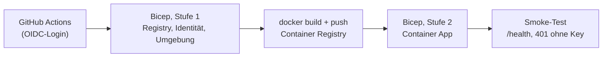

# Deployment auf Azure (Container Apps)

Der Workflow [`deploy-azure.yml`](../.github/workflows/deploy-azure.yml) baut das Image, legt die Infrastruktur mit
[`main.bicep`](main.bicep) an und rollt die App aus. Er läuft nur manuell (Actions → *Deploy to Azure* → *Run workflow*).



## Was angelegt wird

| Ressource | Zweck | Kosten (Richtwert) |
|---|---|---|
| Container App (Consumption, 0,25 vCPU, 0,5 GiB, genau 1 Replik, schläft nicht) | die Anwendung | dauerhaft reserviert: grob 3 bis 6 USD pro Monat (in der Azure-Preisübersicht prüfen), im Leerlauf günstiger abgerechnet als unter Last |
| Container Registry (Basic) | Image | ca. 5 USD pro Monat |
| Log Analytics (30 Tage, max. 0,5 GB pro Tag) | Logs der App | gering, durch Tageslimit gedeckelt |
| Managed Identity mit Rolle *AcrPull* | Image holen ohne Passwort | 0 |

**Schlafen:** Mit `minReplicas = 1` (Standard im Bicep) läuft immer eine Instanz, es gibt keinen Kaltstart, und Kontingent und Daten bleiben bis zum nächsten Deployment erhalten. Wer Kosten sparen will, setzt den Parameter `minReplicas` auf `0` (Scale-to-zero): Im Leerlauf kostet die App dann praktisch nichts, der erste Aufruf danach dauert aber einige Sekunden und setzt Kontingent und Daten zurück.

Die Replikenzahl ist auf 1 festgelegt: Die SQLite-Datenbank liegt im Container und wird bei jedem Start aus den
eingebetteten JSON-Dateien neu aufgebaut. Mehrere Repliken hätten jeweils eine eigene, voneinander abweichende Datenbank.
Änderungen per `update_country` gehen beim Neustart verloren. Das ist für die Demo gewollt.

## Einmalige Einrichtung

Platzhalter in `<…>` ersetzen. Es kommt nichts davon ins Repository.

```bash
az login
az group create --name <rg> --location germanywestcentral

# App-Registrierung für GitHub Actions (OIDC, ohne Client-Secret)
az ad app create --display-name odata-agent-sample-deploy
az ad sp create --id <app-id>
az ad app federated-credential create --id <app-id> --parameters '{
  "name": "github-azure-env",
  "issuer": "https://token.actions.githubusercontent.com",
  "subject": "repo:vompa/ODataAgentSample:environment:azure",
  "audiences": ["api://AzureADTokenExchange"]
}'

# Rechte nur auf die Resource Group. Die Bicep-Datei legt eine Rollenzuweisung (AcrPull) an, deshalb neben
# Contributor auch der RBAC-Administrator (statt der weitergehenden Rolle Owner).
az role assignment create --assignee <app-id> --role Contributor \
  --scope /subscriptions/<subscription-id>/resourceGroups/<rg>
az role assignment create --assignee <app-id> --role "Role Based Access Control Administrator" \
  --scope /subscriptions/<subscription-id>/resourceGroups/<rg>
```

Hinweis zum Betreff des Federated Credentials: Je nach Repository-Einstellung schickt GitHub statt
`repo:<owner>/<repo>:environment:azure` einen Betreff mit unveränderlichen IDs
(`repo:<owner>@<owner-id>/<repo>@<repo-id>:environment:azure`). Meldet die Anmeldung
`AADSTS700213 No matching federated identity record`, steht der erwartete Betreff in der Fehlermeldung. Dann ein
zweites Credential mit genau diesem Betreff anlegen.

Im GitHub-Repository unter *Settings → Secrets and variables → Actions*:

| Typ | Name | Inhalt |
|---|---|---|
| Variable | `AZURE_CLIENT_ID` | App-ID der Registrierung |
| Variable | `AZURE_TENANT_ID` | Verzeichnis-ID |
| Variable | `AZURE_SUBSCRIPTION_ID` | Subscription-ID |
| Variable | `AZURE_RESOURCE_GROUP` | `<rg>` |
| Secret | `READER_KEY_SHA256` | `dotnet run --project src/ODataAgentSample -- hash-key <key>` |
| Secret | `WRITER_KEY_SHA256` | optional, gleicher Weg; ohne Wert gibt es keinen Writer-Zugang |
| Secret | `SMOKE_READER_KEY` | optional, der Klartext-Key zum Reader-Hash; aktiviert den Positiv-Test im Smoke-Test |

Außerdem unter *Settings → Environments* eine Umgebung `azure` anlegen (optional mit Genehmigung durch dich).

### Optional: die öffentliche Demo mit Chat

Die Demo (Landingpage, Zugang mit Code, Chat mit Claude über den eigenen MCP-Server) ist **nur an, wenn
`DEMO_ANTHROPIC_API_KEY` gesetzt ist**. Ohne dieses Secret ändert sich am Deployment nichts. Alle vier Secrets müssen
dann gesetzt sein:

| Secret | Inhalt |
|---|---|
| `DEMO_ANTHROPIC_API_KEY` | dein Anthropic-Key (vorher in der Anthropic-Konsole ein **Ausgabenlimit** setzen) |
| `DEMO_ACCESS_CODE_SHA256` | SHA-256 des Zugangscodes: `printf %s "<code>" \| sha256sum` (den Code selbst gibst du an Eingeladene) |
| `DEMO_COOKIE_KEY` | zufälliger Schlüssel, mindestens 32 Zeichen, signiert das Sitzungs-Cookie |
| `DEMO_API_KEY` | zufälliger Reader-Key, mindestens 32 Zeichen, mit dem die Demo ihren eigenen `/mcp` aufruft |

Nach dem Deployment sind unter der App-Adresse `/` (Landingpage) und `/demo` erreichbar. Impressum und
Datenschutzseite gibt es bewusst nicht (nur Länderdaten, Lesezugriff für wenige Eingeladene). Zum Abschalten das Secret `DEMO_ANTHROPIC_API_KEY` leeren und neu ausrollen.
Zu den Limits und Grenzen siehe den README-Abschnitt „Öffentliche Demo mit Chat“.

### Optional: eigene Domain

Mit einer eigenen Domain (hier als Beispiel `demo.example.com`) läuft die App unter einer kurzen Adresse, das TLS-Zertifikat stellt Azure kostenlos aus und erneuert es selbst.

1. Beim DNS-Anbieter zwei Einträge anlegen: ein `CNAME` von `demo` auf die App-Adresse (`appFqdn`) und ein `TXT` `asuid.demo` mit der Verifizierungs-ID (`az containerapp show -n <name> -g <rg> --query properties.customDomainVerificationId`).
2. Domain anhängen und Zertifikat ausstellen lassen (einmalig, kann bis zu 20 Minuten dauern):

   ```bash
   az containerapp hostname add  -n <name> -g <rg> --hostname demo.example.com
   az containerapp hostname bind -n <name> -g <rg> --hostname demo.example.com \
     --environment <name>-env --validation-method CNAME
   ```

   Die Ausgabe nennt das Zertifikat (`.../managedCertificates/<zertifikatsname>`).
3. Im Repository unter *Settings → Secrets and variables → Actions → Variables* die Variablen `CUSTOM_DOMAIN` (`demo.example.com`) und `CUSTOM_DOMAIN_CERTIFICATE` (`<zertifikatsname>`) setzen. Ohne sie würde jedes Deployment die Domain wieder entfernen, mit ihnen bleibt sie erhalten.

Sind die Variablen leer, läuft die App wie bisher nur unter der Azure-Adresse.

## Anbindung an einen Agenten

```bash
claude mcp add --transport http laender-azure https://<fqdn>/mcp --header "X-Api-Key: <reader-key>"
```

## Aufräumen

Alles liegt in einer Resource Group, das Löschen entfernt sämtliche Kosten:

```bash
az group delete --name <rg>
```

## Grenzen

- Die Daten sind flüchtig (siehe oben). Für echte Daten wäre Azure SQL mit Managed Identity der nächste Schritt.
- Der Smoke-Test prüft Erreichbarkeit und Zugriffsschutz, nicht die fachlichen Antworten.
- Die API-Keys sind einfache gemeinsame Geheimnisse. Mit Entra ID (`Authentication:Jwt:Authority`) lässt sich später
  auf echte Token umstellen.
- Die Container App ist öffentlich erreichbar, geschützt durch API-Key und Rate Limit.
- Das Deployment ist gegen eine echte Azure-Subscription ausgeführt und per Smoke-Test sowie von Hand geprüft
  (`/health`, 401 ohne Key, 200 mit Reader-Key, 403 beim Schreiben als Reader, MCP-Tools). Die Entra-ID-Anmeldung
  (`Authority`) ist damit weiterhin nicht gegen einen echten Identity Provider getestet.
- Die erste Einrichtung der Container-Apps-Umgebung dauerte rund 15 Minuten, spätere Läufe unter 3 Minuten. Das
  OIDC-Token von `azure/login` gilt nur wenige Minuten, deshalb meldet sich der Workflow vor dem Registry-Login
  erneut an.
- Die Swagger-Oberfläche (`/swagger`) ist in Azure über `OpenApi__Enabled=true` eingeschaltet. Sie und das
  OpenAPI-Dokument sind öffentlich lesbar, beschreiben aber nur die Schnittstelle. Daten und `/mcp` verlangen weiterhin
  den API-Key (in der Oberfläche über *Authorize*). Wer das nicht will, entfernt die Zeile im Bicep.
- Hinter dem TLS-Proxy der Container Apps kommen Schema und Client-IP nur als `X-Forwarded-*` an. Die App wertet sie
  aus, wenn `ForwardedHeaders__Enabled=true` gesetzt ist (im Bicep so eingestellt). Standardmäßig ist das aus: Wer die
  App direkt erreicht, könnte die Header sonst fälschen und das IP-basierte Rate Limit umgehen. Ohne diese Einstellung
  zeigten OData-Links `http://`, und das Limit sah für alle anonymen Clients die IP des Proxys.
