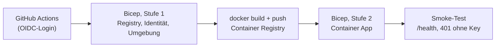

# Deployment auf Azure (Container Apps)

Der Workflow [`deploy-azure.yml`](../.github/workflows/deploy-azure.yml) baut das Image, legt die Infrastruktur mit
[`main.bicep`](main.bicep) an und rollt die App aus. Er läuft nur manuell (Actions → *Deploy to Azure* → *Run workflow*).



## Was angelegt wird

| Ressource | Zweck | Kosten (Richtwert) |
|---|---|---|
| Container App (Consumption, 0,25 vCPU, Scale-to-zero, max. 1 Replik) | die Anwendung | ohne Last praktisch 0, im Gratiskontingent |
| Container Registry (Basic) | Image | ca. 5 USD pro Monat |
| Log Analytics (30 Tage, max. 0,5 GB pro Tag) | Logs der App | gering, durch Tageslimit gedeckelt |
| Managed Identity mit Rolle *AcrPull* | Image holen ohne Passwort | 0 |

Die Replikenzahl ist auf 1 festgelegt: Die SQLite-Datenbank liegt im Container und wird bei jedem Start aus den
eingebetteten JSON-Dateien neu aufgebaut. Mehrere Repliken hätten jeweils eine eigene, voneinander abweichende Datenbank.
Änderungen per `update_country` gehen beim Neustart verloren. Das ist für die Demo gewollt.

## Einmalige Einrichtung

Platzhalter in `<…>` ersetzen. Es kommt nichts davon ins Repository.

```bash
az login
az group create --name <rg> --location germanywestcentral

# App-Registrierung für GitHub Actions (OIDC, ohne Client-Secret)
az ad app create --display-name odata-agent-sample-deploy
az ad sp create --id <app-id>
az ad app federated-credential create --id <app-id> --parameters '{
  "name": "github-azure-env",
  "issuer": "https://token.actions.githubusercontent.com",
  "subject": "repo:vompa/ODataAgentSample:environment:azure",
  "audiences": ["api://AzureADTokenExchange"]
}'

# Rechte nur auf die Resource Group. Owner, weil die Bicep-Datei eine Rollenzuweisung (AcrPull) anlegt.
az role assignment create --assignee <app-id> --role Owner \
  --scope /subscriptions/<subscription-id>/resourceGroups/<rg>
```

Im GitHub-Repository unter *Settings → Secrets and variables → Actions*:

| Typ | Name | Inhalt |
|---|---|---|
| Variable | `AZURE_CLIENT_ID` | App-ID der Registrierung |
| Variable | `AZURE_TENANT_ID` | Verzeichnis-ID |
| Variable | `AZURE_SUBSCRIPTION_ID` | Subscription-ID |
| Variable | `AZURE_RESOURCE_GROUP` | `<rg>` |
| Secret | `READER_KEY_SHA256` | `dotnet run --project src/ODataAgentSample -- hash-key <key>` |
| Secret | `WRITER_KEY_SHA256` | optional, gleicher Weg; ohne Wert gibt es keinen Writer-Zugang |
| Secret | `SMOKE_READER_KEY` | optional, der Klartext-Key zum Reader-Hash; aktiviert den Positiv-Test im Smoke-Test |

Außerdem unter *Settings → Environments* eine Umgebung `azure` anlegen (optional mit Genehmigung durch dich).

## Anbindung an einen Agenten

```bash
claude mcp add --transport http laender-azure https://<fqdn>/mcp --header "X-Api-Key: <reader-key>"
```

## Aufräumen

Alles liegt in einer Resource Group, das Löschen entfernt sämtliche Kosten:

```bash
az group delete --name <rg>
```

## Grenzen

- Die Daten sind flüchtig (siehe oben). Für echte Daten wäre Azure SQL mit Managed Identity der nächste Schritt.
- Der Smoke-Test prüft Erreichbarkeit und Zugriffsschutz, nicht die fachlichen Antworten.
- Die API-Keys sind einfache gemeinsame Geheimnisse. Mit Entra ID (`Authentication:Jwt:Authority`) lässt sich später
  auf echte Token umstellen.
- Die Container App ist öffentlich erreichbar, geschützt durch API-Key und Rate Limit.
- Dieses Deployment ist bisher nicht gegen eine echte Azure-Subscription ausgeführt. Getestet sind der Docker-Build,
  der Containerstart mit den Azure-Umgebungsvariablen und die Bicep-Kompilierung.
